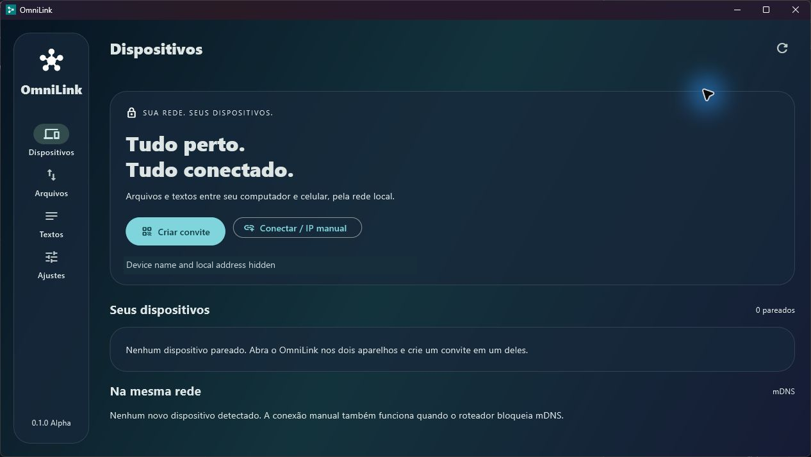
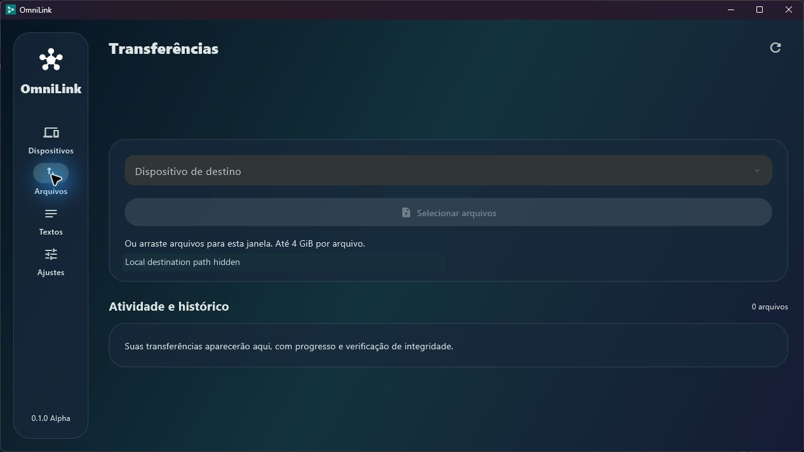
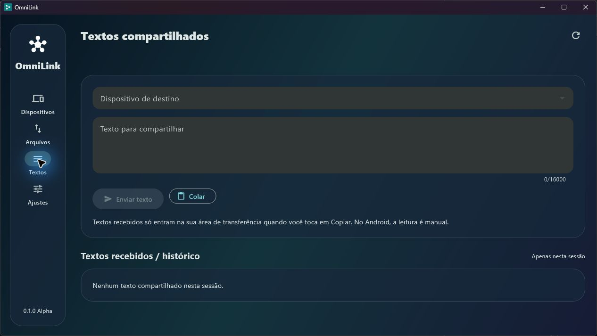

# OmniLink 0.1.1 Alpha

An open-source Flutter application for sharing files and text between Windows and Android over a local network. Material 3 interface with transparency, blur, light/dark/system themes, and English/Brazilian Portuguese localization. Select your language in Settings → Language; the choice is saved and applies immediately. English is the default when no preference has been saved.

**Delivery status:** The Android debug APK and Windows release executable have been built and verified. The APK signature has been validated. Integration between physical devices and visual performance still require validation. See [VALIDATION.md](VALIDATION.md) for exact results and limitations.

## Download and try it

**[Download the latest release](https://github.com/nexora-sudo/OmniLink/releases/latest)** · [Quick start](docs/QUICK_START.md) · [Known issues and limitations](docs/KNOWN_ISSUES.md) · [Report a bug](https://github.com/nexora-sudo/OmniLink/issues/new?template=bug_report.md)

| Platform | Download | Install |
| --- | --- | --- |
| Android 7+ | [Android APK](https://github.com/nexora-sudo/OmniLink/releases/download/v0.1.1/OmniLink-0.1.1-android.apk) | Open the APK on your phone. This Alpha uses a development signature. |
| Windows x64 | [Windows ZIP](https://github.com/nexora-sudo/OmniLink/releases/download/v0.1.1/OmniLink-0.1.1-windows-x64.zip) | Extract the entire ZIP and open `omnilink.exe`. Keep the DLLs and `data` folder together. |

Connect both devices to the same Wi-Fi/network, keep both apps open, create an invitation on one device, scan its QR code on Android, and confirm pairing. Select the paired device, send a small file, and accept it on the receiver. See the [quick start](docs/QUICK_START.md) for button names, saving files, and troubleshooting.

### Real screenshots

Captured from the running Windows Build 2 application. These screenshots show the previous Portuguese-only Build 2 interface; v0.1.1 also supports English. These screens show an unpaired session; they do not demonstrate a completed transfer. The computer name, local IP address, and local destination path have been obscured.

**Devices**



<details>
<summary>Files and text screens</summary>

**Files**



**Text**



</details>

### 15-second interface tour

[](https://github.com/nexora-sudo/OmniLink/releases/download/v0.1.0-alpha-build2/omnilink-windows-tour.mp4)

**[Watch or download the short MP4](https://github.com/nexora-sudo/OmniLink/releases/download/v0.1.0-alpha-build2/omnilink-windows-tour.mp4).** This is a captioned slideshow of the real screenshots above, not a recording of a device-to-device transfer. Android screenshots and physical-device transfer validation are still pending.

## Version 0.1.1

English and Portuguese interfaces with a persistent language selector. See the [v0.1.1 update log](docs/UPDATE_LOG_0.1.1.md).

## Features

- mDNS discovery (`_omnilink._tcp`), invitation-based connections, QR code scanning with the Android camera, and manual IPv4/port/certificate/code entry.
- Single-use invitations that expire after five minutes, confirmation on the receiving device, TLS certificate pinning, credentials in secure storage, and device unpairing.
- Heartbeat with connected/connecting/disconnected states and reconnection to known devices. IP address updates through mDNS.
- Chunked file transfers, multiple file selection, drag and drop on Windows, progress, MB/s, estimated time remaining, cancellation, and resuming after interruptions or restarts.
- Full-file SHA-256 verification before marking a received file as complete. Validated filenames, a 4 GiB limit per file, and confirmation for every incoming transfer.
- Bidirectional text sharing with manual copying, optional history, and automatic clipboard sending on Windows, disabled by default.
- Actual device name, operating system, version, IP address, and last connection time. Battery level and free storage are displayed only when reported by the system.
- Transfer history and settings stored in SQLite, with an option to launch at Windows startup.
- Configurable destination folder on Windows. Android receives files in private app storage and offers gallery/Downloads saving, "Save as…" through the Storage Access Framework (SAF), and sharing to other applications.

No account, cloud service, analytics, or external transport. Development dependencies require internet access during installation and builds; sharing between devices does not.

## Development environment

This delivery uses **Flutter 3.47.9 stable / Dart 3.13.7**. Keep `pubspec.lock`. The dependency resolver selected compatible stable versions; newer major versions were not adopted automatically.

### Windows

1. Install Flutter and add `flutter/bin` to `PATH`.
2. Install Visual Studio with **Desktop development with C++**, MSVC, CMake, Windows SDK, and the ATL library, which is required by secure storage.
3. Enable Windows Developer Mode for the symbolic links used by plugins.
4. Run `flutter doctor -v` and resolve the Windows requirements.

### Android

1. Install Android Studio, JDK 17, and Android SDK command-line tools.
2. Install SDK platform 36 and the build-tools/NDK versions requested by Flutter/Gradle.
3. Run `flutter doctor --android-licenses` and review the licenses.
4. Enable USB debugging on your phone, authorize the computer, and check `flutter devices`.

The project targets SDK 36. Before upgrading to API 37, implement Android 17's local network permission. The app does not request broad storage access, location access, or background execution. The camera is needed only for QR code scanning. Android 7–9 requests legacy storage write permission when saving to public folders; see the Build 2 section below.

## Running

Open a terminal **in the folder containing `pubspec.yaml`**:

```sh
flutter pub get
flutter analyze
flutter test
flutter run -d windows
```

In another terminal, run the app on the connected Android device:

```sh
flutter devices
flutter run -d ANDROID_DEVICE_ID
```

In the original delivery workspace, the prepared SDK is located at `../../work/flutter/bin`, relative to the project folder. PowerShell example for running tests without changing `PATH`:

```powershell
$env:PUB_CACHE = (Resolve-Path ../../work/pub-cache).Path
& ../../work/flutter/bin/flutter.bat test --no-pub
```

This path is specific to the original delivery workspace and is not included in the distribution ZIP. For a GitHub checkout, use your own Flutter installation.

## First pairing

The application starts in English unless a language preference has been saved. Use Settings → Language to choose English or Português (Brasil); the English and Portuguese labels below refer to the same actions.

1. Connect both devices to the same network and keep OmniLink open.
2. On Windows, allow the application through the firewall for private networks only. The default TCP port is `45832`; mDNS uses UDP `5353`. No firewall rules are changed automatically.
3. On one device, click **Create invitation** (Criar convite). If multiple network interfaces are available, select the IPv4 address on the same network as the other device.
4. On Android, use **Scan QR code** (Ler QR Code). Alternatively, use **Connect / Manual IP** (Conectar / IP manual) on the other device to paste the invitation. The **Manual connection details** section provides the IPv4 address, port, SHA-256 fingerprint, and secret code.
5. Confirm the name/address on the device that created the invitation. Closing the dialog revokes the invitation.
6. Select the paired device. Under **Files** (Arquivos), choose files or drag them into the app, then confirm receipt on the destination device.

The fingerprint and code must come directly from the other device's invitation. The mDNS announcement does not authenticate devices. Avoid sharing invitations through public channels. Firewall permission may be required in both directions for bidirectional communication.

## Files and resuming transfers

Each file is initially received as `.ID.omnipart`. Only after SHA-256 verification is it moved to `OmniLink-ID/original-filename` inside the selected folder. Existing files are not overwritten.

If the network disconnects, the history displays the error and a **Resume** action on the sender. The receiver confirms again and reports how many bytes it has persisted. After a restart, the source file must remain accessible at the same path. If the Android file picker cache has been cleared, select the original file again. Identical files sent to the same paired device are handled idempotently, without duplicate copies.

**Cancel** stops the transfer and preserves the partial file. **Delete partial file** on the receiver removes its bytes. The history is retained. A disconnection may prevent remote confirmation of cancellation; the interface reports this situation.

On Android, private app storage avoids broad permissions and SAF URLs that cannot be used with `dart:io`. **Save as…** lets you choose where to export a completed file without loading it entirely into RAM. This Alpha does not support configuring a SAF directory tree as a permanent automatic destination. Uninstalling the app removes its private files; export any files you want to keep.

## Clipboard

Received text does not automatically overwrite the clipboard. Use **Copy**. On Android, use **Paste** while the application is in the foreground, respecting system restrictions. On Windows, automatic sending is optional and works while the process is running and a destination is selected. Any copied text, including passwords, may be sent while this option is enabled.

Text history is disabled by default. When enabled, it stores up to 100 entries in the local SQLite database without additional encryption. It can be cleared in settings.

## Builds

```sh
# Windows: requires Visual Studio / C++ / Windows SDK
flutter build windows --release

# Installable APK for Alpha testing, signed with a development key
flutter build apk --debug
```

Expected files, **available only after a successful build**:

- `build/windows/x64/runner/Release/omnilink.exe`: distribute the entire `Release` folder, including DLLs and `data`, rather than the executable alone.
- `build/app/outputs/flutter-apk/app-debug.apk`: install using `adb install -r APK_PATH` or the Android package installer.

To automate validation and check the artifact's existence and hash:

```powershell
./scripts/build.ps1 -Target windows
./scripts/build.ps1 -Target android
```

The `packaging/windows/omnilink.iss` file can generate an installer with Inno Setup 6 after the Windows build. This has not been run on this machine. The Android release configuration does not silently use a debug key: configure a keystore and `signingConfig` before distributing a release. Public builds and installers should also be signed and tested.

## GitHub

The source is published in [nexora-sudo/OmniLink](https://github.com/nexora-sudo/OmniLink). The repository is public, so anyone can download and test the application. The [latest v0.1.1 release](https://github.com/nexora-sudo/OmniLink/releases/tag/v0.1.1) includes the Android APK, Windows ZIP, source archive, installation instructions, and SHA-256 checksums.

The repository includes an MIT license, changelog, contribution guide, ignore rules, protocol documentation, security documentation, a validation plan, and two workflows:

- `ci.yml`: formatting, analysis, and tests on Windows for pushes and pull requests.
- `build.yml`: manually triggered builds of the debug APK and Windows release folder, uploaded as workflow artifacts.

Check the [Actions page](https://github.com/nexora-sudo/OmniLink/actions) for current workflow results. The published v0.1.1 binaries were built and verified locally. Do not commit builds, databases, credentials, or caches.

## Architecture

```text
lib/
  communication/  TLS identity, pairing, authentication, transport, and transfers
  models/         paired devices, invitations, transfers, and validation
  persistence/    repository interface, SQLite, and secure storage
  services/       mDNS discovery and native features
  ui/             screens and glass theme
android/          Kotlin host, storage, and SAF export
windows/          C++ host, free storage, and plugin integration
```

Transport uses local HTTPS: HTTP framed over TCP/TLS, without an intermediary server. See the [protocol](docs/PROTOCOL.md), [security documentation](docs/SECURITY.md), and [test plan](docs/TESTING.md).

## Known limitations

- Native builds have completed. Camera access, mDNS between devices, secure storage on physical hardware, the share sheet, and startup integration still require testing on physical devices.
- Android usage is limited to the foreground. There is no persistent service or guarantee that transfers will continue while the screen is asleep.
- Private/link-local IPv4 only. IPv6-only networks and the CGNAT range `100.64/10` are not supported in this version.
- No automatic identity rotation or independent security audit.
- No actual FPS measurements have been collected. Achieving 60 FPS depends on the hardware and requires profiling.
- Large files use streaming hashes and chunked transfers, but throughput and memory usage on midrange phones have not yet been measured.
- Edge cases involving process termination between file finalization and persistence may require manual recovery (`docs/PROTOCOL.md`).
- Real Windows screenshots and a short interface tour are available above. Android screenshots and physical-device transfer validation are still pending.

## Technical references

- [Flutter: installation](https://docs.flutter.dev/install)
- [Bonsoir: mDNS and resolved addresses](https://pub.dev/packages/bonsoir)
- [SQLite for Dart: native assets](https://pub.dev/packages/sqlite3)
- [Secure storage](https://pub.dev/packages/flutter_secure_storage)
- [Android: local network permissions](https://developer.android.com/privacy-and-security/local-network-permission)

## License

MIT — see [LICENSE](LICENSE). Dependencies retain their own licenses, accessible under **Settings → Open-source licenses**.

## Test binaries — verified on October 31, 2026

The debug APK uses a development signature, with `minSdk 24` and `targetSdk 36`, supporting ARM64, 32-bit ARM, and x86_64. The Windows package is x64 and must be fully extracted before opening `omnilink.exe`. No Windows installer has been generated.

The `desktop_drop` 0.6.1 plugin is included in `packages/desktop_drop` with its original license and Android native registration removed. Drag and drop is used only on Windows; Android uses the system file picker. See [packages/desktop_drop/OMNILINK_PATCH.md](packages/desktop_drop/OMNILINK_PATCH.md).

## Build 2 — saving received files

After a transfer completes, the **Files** page offers:

- **Android:** **Save to gallery** for photos/videos in the OmniLink album, and **Save to Downloads** for any file.
- **Windows:** **Save to Downloads**, inside `Downloads/OmniLink`. This remains the default destination; if the file is already there, the action confirms its location without creating another copy.
- **Android:** **Save as…** remains available for manually choosing another folder.

Saving is manual and preserves the received copy. Android 10+ uses MediaStore. Android 7–9 requests `WRITE_EXTERNAL_STORAGE` only when saving, with the permission limited to those versions in the manifest. Errors are displayed, and partial export copies are removed. On modern Android versions, photos go to `Pictures/OmniLink`, videos to `Movies/OmniLink`, and other files to `Download/OmniLink`. The device's gallery may take a few moments to update the album.

The application does not require permission to read the gallery: it only publishes files it has received. Support for displaying a particular format depends on the applications installed on the device.
